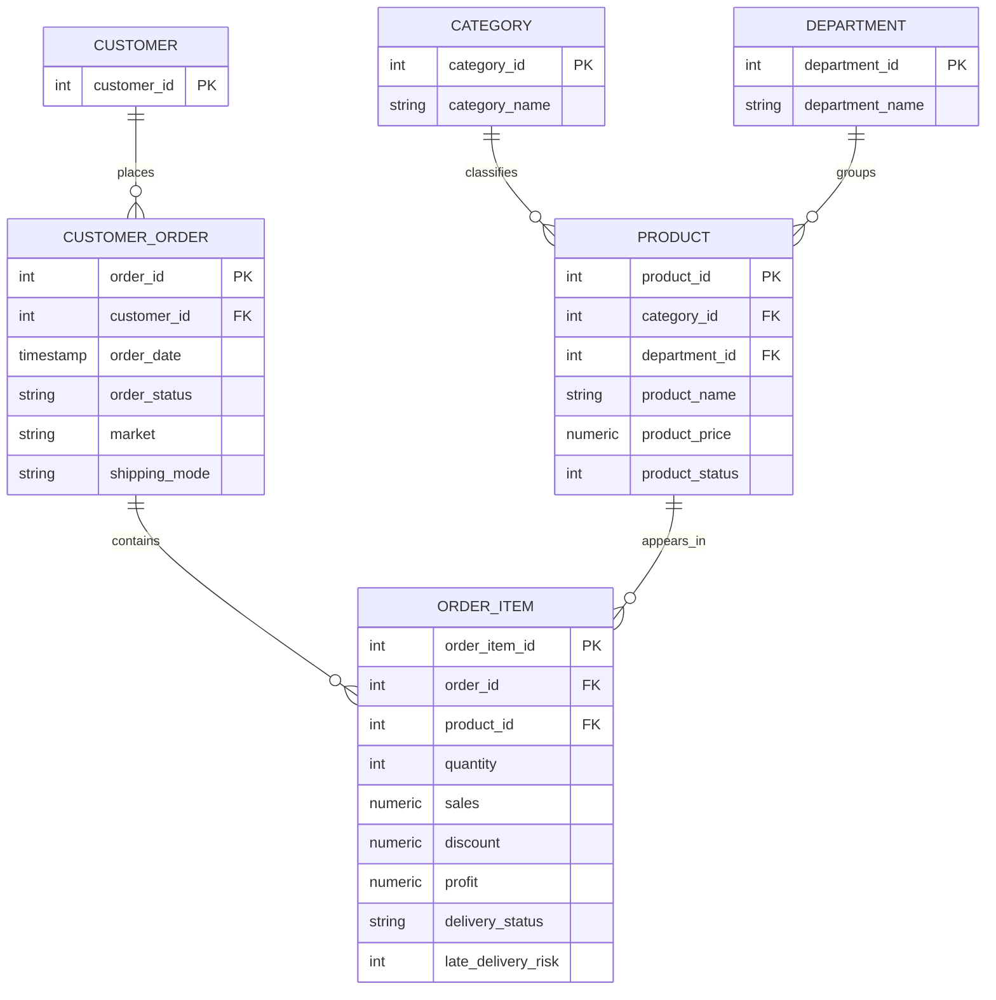

# Entity-Relationship Diagram

## Purpose

This diagram presents the proposed logical data model for the Supply Chain & Operations Intelligence project.

The model separates customer, order, order-item, product, category, and department information to support structured SQL analysis, reduce unnecessary duplication, and enable reliable business reporting.

The model is based on the DataCo Smart Supply Chain dataset and is subject to validation against the source data.

## Proposed Logical Model

## Validation Status

The initial staging import completed successfully with 180,519 rows and 53 source columns.

Initial profiling established the following:

- 65,752 distinct order IDs and 180,519 distinct order-item IDs.
- No duplicate non-empty order-item IDs were found.
- No missing values were found in the five key identifier fields checked.
- `Customer Id` and `Order Customer Id` matched in all rows.
- No order was found with multiple distinct customer IDs in the order-level consistency check.
- The checked order-level attributes showed no conflicting values within an order.
- No conflicting product names or prices were found for a product ID.
- No conflicting category names or department names were found for their respective IDs.
- No product was found associated with multiple categories or departments in the completed checks.
- The delivery-status counts agreed with the corresponding late-delivery-risk counts.

These results support the proposed logical relationships but do not yet establish full referential integrity or validate every business rule.

## Outstanding Validation

Before implementing the final schema, verify:

- That every foreign-key value references an existing parent record.
- That all candidate primary keys are unique and non-null.
- That the product identifier used by order items matches the product identifier used in the product entity.
- That category and department identifiers have no missing or invalid values.
- That numerical measures and date fields have appropriate data types and valid values.
- That sales, discounts, and profit are aggregated at the correct level.

## Design Notes

- The staging table preserves the source fields as text for initial inspection.
- Entity and column names in this diagram are simplified logical names; the final PostgreSQL schema may use different names.
- PostgreSQL data types and constraints will be finalized after validation.
- The model is a proposed normalized design, not a representation of the original denormalized CSV structure.
